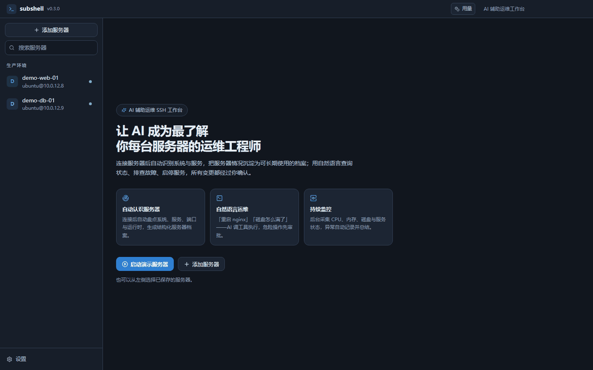
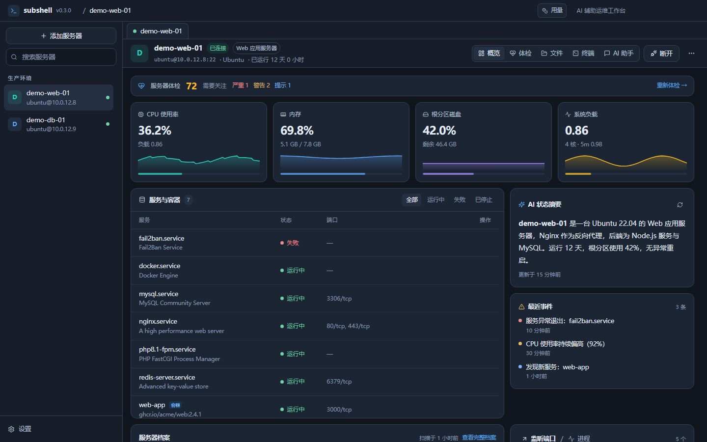
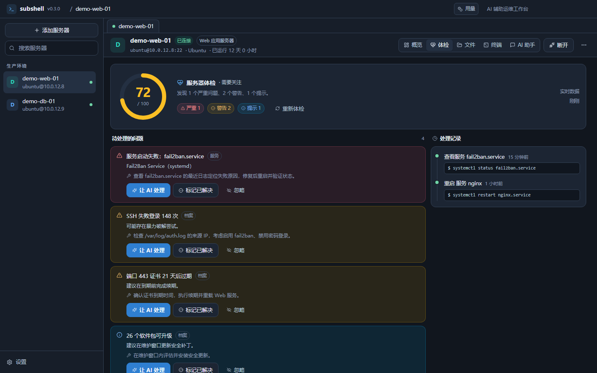
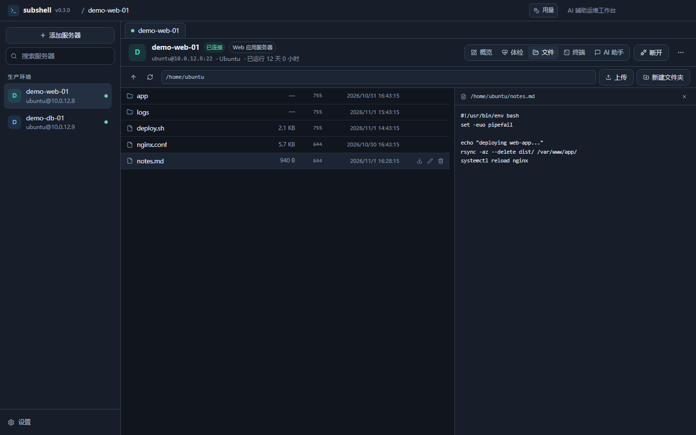
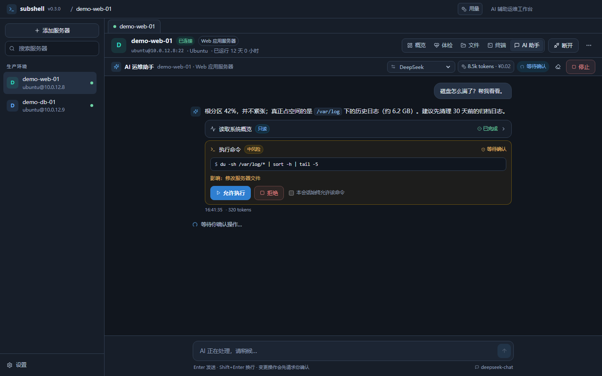

# Subshell

> An AI-assisted SSH operations workbench that actually knows your servers.

Subshell combines an **interactive SSH terminal**, **automatic server discovery**, **continuous monitoring**, **a health report** and an **AI operations assistant** in one desktop app. On connect it behaves like an engineer who already knows the machine: it inventories the system and services, builds a long-lived profile, watches key metrics and lets you troubleshoot and control services in natural language.



| Overview | Health |
| --- | --- |
|  |  |

| Files | AI Assistant |
| --- | --- |
|  |  |

## Highlights

- **Automatic discovery** — OS, CPU/memory/disk, every mount point and inode usage, systemd services, Docker containers, listening ports, runtimes, web sites, security posture, certificates, recent package installs.
- **Server health report** — profile risks, unacknowledged alerts, failed services and open checklist items are aggregated into a scored report. Each issue can be handed to the AI; every execution is recorded as a ticket so you can review what was done afterwards.
- **Long-lived profile** — structured JSON profile per server with role, summary, services, risks, checklist and notes. History is compacted into short summaries so the file never grows without bound.
- **Continuous monitoring** — background sampling of CPU, memory, disk, load and network; service, port and process snapshots every 60 seconds; new services are discovered and tracked automatically.
- **Natural language operations** — "restart nginx", "why is the disk full", "check fail2ban logs". The model calls tools, and risky actions require your approval.
- **Verified operations** — after a service action the app checks `systemctl is-active` / container state and feeds the result back to the model.
- **Interactive terminal** — xterm.js with resize, copy/paste and reconnect. Press `Tab` for command completion; use **Command analysis** to understand a command before running it.
- **File manager** — built-in SFTP browser with directory listing, text preview, upload, download, create, rename and delete.
- **Port forwarding** — map a remote service onto local `127.0.0.1` (for example a remote MySQL from your local client). Loopback only.
- **MCP server** — expose your servers as MCP tools for Claude Code, Cursor and similar agents. Read-only by default, token-protected, loopback only.
- **Token usage & estimated cost** — per-conversation token counts with a cost estimate based on prices you enter manually.
- **Bilingual UI** — Simplified Chinese and English.

## About the installers

Builds are currently **unsigned** (code signing certificate pending), so the OS will warn once:

- **Windows**: SmartScreen shows "Windows protected your PC" → **More info** → **Run anyway**. Some antivirus products may flag an unsigned binary that opens SSH connections — verify where you downloaded it from.
- **macOS**: right-click the app → **Open** → confirm.
- **Verify the download**: GitHub shows a SHA-256 digest for every release asset.
- **Prefer building it yourself**: `npm install && npm run build`; the output lands in `out/`.

This section will be removed once signed builds are available.

## Quick start

Requirements: Node.js 22+, Windows 10/11 (also runs on macOS/Linux), and optionally a Linux server reachable over SSH — the built-in demo host needs no real machine.

```bash
npm install
npm run dev
```

Build a Windows portable package:

```bash
npm run dist:win
```

### Try it in five minutes

1. Launch the app and click **Start demo server** on the welcome page.
2. A simulated Ubuntu 22.04 host starts on `127.0.0.1` (random port); Subshell connects, runs discovery and starts monitoring.
3. Check **Overview** for metrics, services, events and the AI summary, and **Health** for the issue list.
4. Open **AI Assistant** and ask: "check the server status", "restart nginx", "why did fail2ban fail?".
5. Change operations show an approval card and only run after you confirm.

The demo uses the built-in **demo model** (no API key needed) and a fixed script that exercises the full tool chain.

### Use a real server

1. **Add a server**: host, port, username, password or SSH key.
2. **Configure a model** in **Settings → Providers**: OpenAI-compatible (OpenAI, DeepSeek, Moonshot...), Anthropic Messages, or Ollama.
3. Connect. Subshell discovers the server, builds a profile and starts monitoring. The host key is recorded on first connect and a changed fingerprint refuses the connection.

## Configuration

Settings live under the app data directory (defaults to `subshell-runtime/data` next to the executable, falling back to `%APPDATA%\subshell\data`):

```
data/
  settings.json
  servers.json
  secrets.json        # encrypted with the OS keychain
  providers.json
  known-hosts.json
  audit.jsonl
  servers/<id>/
    profile.json      # profile + compacted history
    runtime.json      # metric samples and events
    chat.json         # conversation history
    health.json       # issue status set by you
    tickets.json      # execution records for issues
    tunnels.json      # port forwarding rules
```

Credentials and API keys are encrypted with the OS keychain (DPAPI / Keychain / libsecret) and never written to config files or logs.

## Security model

- The model only proposes tool calls; local rules decide risk and the user decides execution.
- Read-only tools may run automatically; changes require approval. Smart mode only auto-runs `service` actions classified as low risk — arbitrary commands and profile writes always ask.
- Dangerous commands (wiping the root filesystem, formatting, shutdown, firewall flush) are blocked locally. Commands wrapped in `sh -c`, `eval` or `bash -lc` are re-classified recursively.
- Sensitive files (`/etc/shadow`, private keys, `.env`, `.npmrc`, `.git-credentials`, cloud credentials) cannot be read by the model.
- Command output, logs, file contents, the server profile and notes are treated as untrusted data, never as instructions.
- The renderer runs with Electron sandbox enabled and a production CSP; it can only reach the main process through the whitelisted IPC surface.
- The MCP server binds to loopback, requires a bearer token and exposes read-only tools by default. Mutations require an explicit opt-in and still pass the local risk engine.
- Every change is written to the audit log.

## Architecture

- Electron 38 + React 19 + TypeScript (strict)
- ssh2 for connections, command execution, shells, SFTP and port forwarding
- xterm.js for the terminal
- zustand for state, Tailwind CSS 4 for styling
- A small in-house model adapter: OpenAI Chat Completions, Anthropic Messages, Ollama (streaming + tool calls, timeouts and retries)
- Built-in MCP server: JSON-RPC over HTTP

See [docs/ARCHITECTURE.md](docs/ARCHITECTURE.md) for details.

## Development

```bash
npm run dev            # development with HMR
npm run build          # production build
npm run typecheck      # type checking
npm run lint           # ESLint
npm run format         # Prettier
npm test               # unit and integration tests
npm run test:coverage  # coverage report
```

Screenshots and the demo GIF are generated from the production build with a mocked `window.subshell`:

```bash
npm run build
node scripts/ui-preview.mjs   # needs local Edge/Chrome
python scripts/make-gif.py    # needs Pillow
```

The suite (60 tests) covers discovery parsing, profile building, risk classification and nested commands, sensitive paths, CPU math, alerting, health aggregation, SSH end-to-end, the agent loop (auto-run, approval, rejection, token-budget trimming), streaming protocol parsing, the MCP server, data migration and IPC registration.

## Known limitations

- Focused on Linux + systemd; other init systems get limited information.
- Port forwarding supports local (`-L`) tunnels only; remote forwarding and SOCKS are not implemented.
- MCP uses JSON-RPC over HTTP (no SSE); clients without HTTP transport need a bridge such as `mcp-remote`.
- Update support is "check + open the download page". Silent install requires code signing — see [docs/RELEASING.md](docs/RELEASING.md).
- Real SSH hosts use the standard ssh2 stack; validate on a non-production host before relying on it.
- Monitoring data and profiles stay local; multi-user sync is not implemented.
- AI summaries and agent runs consume model tokens; auto-summary can be disabled in settings.
- On Windows, `npm install` may try to compile ssh2's optional native dependency `cpu-features`; without C++ build tools it is skipped and SSH still works.
- In environments without a desktop session (CI, servers, some sandboxes) Electron cannot create a window — that is an environment limit, not an app failure.

## License

[MIT](LICENSE)
