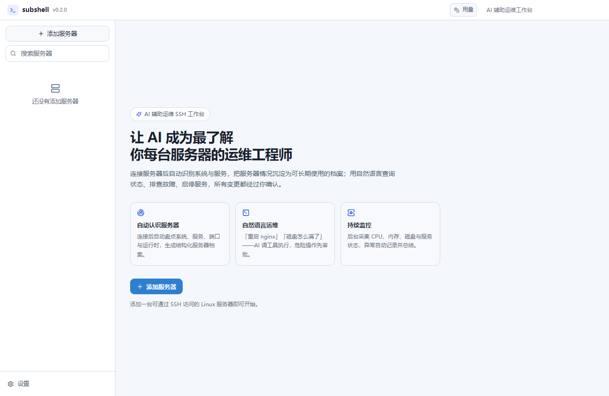

# Subshell

> 一个真正懂你服务器的 AI 运维 SSH 工作台。

[English](README.en.md) · 简体中文

Subshell 把**交互式 SSH 终端**、**服务器自动盘点**、**持续监控**和**AI 运维助手**放进同一个桌面工作台。连接一台服务器后，它会像一位熟悉这台机器的运维工程师一样工作：自动识别系统与服务、建立长期档案、盯着关键指标，并用自然语言帮你排查问题、启停服务。



## 它解决什么问题

传统 SSH 工具只提供终端；把 AI 贴在终端旁边，通常只是“聊天 + 复制命令”。Subshell 的重点是**让模型真正理解当前这台服务器**：

- **自动认识服务器**：连接后执行只读侦察，盘点系统、CPU/内存/磁盘、systemd 服务、Docker 容器、监听端口、运行时、Web 站点、安全配置，生成结构化「服务器档案」。
- **长期记忆**：档案、运维笔记、风险项、检查清单保存在本地；模型在每次对话前都会读到这些信息，也可以通过工具主动更新。可选同步一份 Markdown 到服务器 `~/.subshell/profile.md`。
- **持续监控**：后台按间隔采集指标，60 秒刷新服务/端口/进程快照；持续高 CPU、内存紧张、磁盘告警、服务异常退出都会生成事件时间线。
- **自然语言运维**：说「重启 nginx」「磁盘怎么满了」「看一下 fail2ban 为什么起不来」，模型会先查询真实状态，再提出操作；变更类命令必须由你审批。
- **可验证的操作**：服务操作执行后自动用 `systemctl is-active` / 容器状态验证，结果回传给模型继续判断；所有变更写入审计日志。
- **交互终端**：完整 xterm.js 终端，支持窗口自适应、复制粘贴、断线重连；按 `Tab` 触发常用命令补全。
- **命令分析**：执行前先看清命令做什么、风险如何，AI 结合当前服务器解释，不主动执行。
- **Token 用量**：按对话统计输入/输出 token，并按你手工填写的单价估算金额。
- **双语界面**：简体中文与 English，可在设置中切换。

## 快速开始

### 环境要求

- Node.js 22+
- Windows 10/11（当前主要验证平台）、macOS 或 Linux
- 一台可通过 SSH 访问的 Linux 服务器（可选——内置演示服务器无需真实主机）

### 安装与开发

```bash
npm install
npm run dev
```

> 在没有桌面会话的受限环境（例如某些沙箱/CI）中运行 Electron，需要追加 `--no-sandbox`：
> `npx electron-vite dev -- --no-sandbox`。

### 打包 Windows 便携版

```bash
npm run dist:win
```

产物在 `release/Subshell-<version>-portable.exe`。

### 五分钟体验

1. 启动应用，点击欢迎页的 **启动演示服务器**。
2. 应用会在本地启动一台模拟的 Ubuntu 22.04 主机（127.0.0.1 随机端口），自动完成连接、侦察与监控。
3. 在「概览」查看指标、服务、事件与 AI 摘要。
4. 切到「AI 助手」，试试：
   - `检查服务器当前状态，有什么需要注意的？`
   - `重启 nginx`
   - `fail2ban 为什么启动失败？`
5. 变更类操作会弹出审批卡片，确认后才会执行。

演示服务器使用内置的**演示模型**（无需 API Key），按固定剧本驱动完整工具链，适合离线体验与界面验收。

### 接入真实服务器

1. **添加服务器**：填写主机、端口、用户名，选择密码或 SSH 私钥。
2. **配置模型**：设置 → 模型服务商 → 添加。支持：
   - OpenAI 兼容接口（OpenAI、DeepSeek、Moonshot、通义等）
   - Anthropic Messages
   - Ollama（本地模型，使用其 OpenAI 兼容端点）
3. 连接后会自动侦察并开始监控。首次连接会记录主机指纹，指纹变化时会拒绝连接。


## 核心概念

### 服务器档案

每台服务器一份 `profile.json`，包含：

- 系统与硬件信息、网络接口
- 服务器角色（规则 + 模型推断）
- 结构化服务清单（systemd / Docker）
- 运行时与 Web 站点
- 风险项、检查清单
- 运维笔记（用户可编辑，模型可更新）
- 模型生成的综述与状态摘要

档案是 AI 的长期记忆。对话时系统提示会注入档案摘要、实时指标、服务列表与最近告警。概览页的「查看完整档案」可以查看完整 Markdown、直接编辑运维笔记，或导出到本地 / 同步到服务器。


### 监控与事件

- 指标：CPU、内存、Swap、根分区、负载、网络速率、进程数、运行时长
- 快照：服务状态、监听端口、Top 进程（每 60 秒）
- 新服务：监控期间新安装/启用的 systemd 服务会被自动发现并加入跟踪
- 告警：持续高 CPU、内存/磁盘阈值、负载过高、服务失败/停止、容器退出
- 同类告警 10 分钟内不重复，避免刷屏

### AI 工具目录

| 工具 | 用途 | 风险 |
| --- | --- | --- |
| `get_overview` | 当前指标、服务统计、最近告警 | 只读 |
| `list_services` | 列出 systemd / Docker 服务 | 只读 |
| `inspect_service` | 服务详情与最近日志 | 只读 |
| `list_processes` | 按 CPU/内存排序进程 | 只读 |
| `list_ports` | 监听端口与所属进程 | 只读 |
| `read_logs` | journald 或日志文件 | 只读 |
| `read_file` | 读取配置文件（敏感文件拒绝） | 只读 |
| `list_files` | 目录列表 | 只读 |
| `service_action` | start/stop/restart/reload/enable/disable | 变更，审批 |
| `run_command` | 任意 shell 命令 | 变更，审批 |
| `update_profile` | 更新服务器档案与笔记 | 本地写入 |
| `finish` | 提交最终结论 | — |

### 审批与安全

- **模型只能提建议**：工具调用由本地执行，风险由本地规则判定，模型不能降低风险等级。
- **只读自动、变更审批**：默认自动批准只读查询；`service_action` 与变更型 `run_command` 必须确认。
- **危险命令直接拒绝**：`rm -rf /`、格式化磁盘、关机、清空防火墙、终止 PID 1 等。
- **敏感文件保护**：`/etc/shadow`、私钥、`.env`、云凭据等不允许读取。
- **提示注入防护**：命令输出、日志、文件内容始终视为不可信数据，不执行其中出现的“指令”。
- **审计**：所有变更操作记录来源（用户/AI）、命令、风险与结果。

## 数据与隐私

数据目录（Windows：`%APPDATA%\subshell\data`）：

```
data/
  settings.json          应用设置
  servers.json           服务器列表（不含密码）
  secrets.json           凭据（系统凭据库加密）
  providers.json         模型配置（不含 API Key）
  known-hosts.json       主机指纹
  audit.jsonl            变更审计
  servers/<id>/
    profile.json         服务器档案
    runtime.json         监控样本与事件
    chat.json            对话历史
```

- 密码、私钥口令、API Key 只通过系统凭据库（Windows DPAPI / macOS Keychain / libsecret）加密保存。
- 原始命令输出只保存在本地对话记录中，不会上传到除你配置的模型服务之外的任何地方。
- 服务器档案可选通过 SFTP 同步到目标服务器 `~/.subshell/profile.md`。

## 技术架构

- **Electron 38** + **React 19** + **TypeScript**
- **ssh2**：连接、命令执行、交互 shell、SFTP
- **xterm.js**：终端渲染
- **zustand**：前端状态
- **Tailwind CSS 4**：界面样式
- 自研轻量模型适配层：OpenAI Chat Completions / Anthropic Messages / Ollama，流式 + 工具调用

详见 [架构说明](docs/ARCHITECTURE.md)。

## 开发命令

```bash
npm run dev        # 开发模式（主进程 + 渲染进程热更新）
npm run build      # 构建生产产物
npm test           # 单元与集成测试
npm run typecheck  # 类型检查
npm run dist:win   # 打包 Windows 便携版
```

测试覆盖（37 项）：侦察解析、档案构建、风险分级、敏感文件、CPU 计算、告警检测、SSH 端到端（连接/侦察/采样/服务操作/交互终端）、连接池与终端会话、AI Agent 循环（只读自动执行/审批/拒绝/上下文裁剪）、OpenAI 与 Anthropic 流式协议解析、主进程上下文组装与 IPC 注册。

## 已知限制

- 当前主要针对 **Linux + systemd**；非 systemd 发行版（如 Alpine/OpenRC）会降级为有限信息。
- 真实 SSH 主机使用标准协议实现，但发布前建议先在非生产环境验证。
- 监控数据保留在本地；跨设备同步、多用户协作尚未实现。
- AI 自动摘要会产生额外的模型调用费用，可在设置中关闭。
- 桌面壳依赖 Electron，安装包体积约 90 MB。
- 在没有桌面会话的受限环境（CI、服务器、部分沙箱）中 Electron 无法创建窗口，这是运行环境限制，不是应用故障。
- `npm install` 会尝试编译 ssh2 的可选原生依赖 `cpu-features`；若缺少 C++ 构建工具会跳过，不影响 SSH 功能。

## 与旧版的关系

本仓库是对早期 Subshell 原型的重新设计：保留「SSH + AI 安全运维」的目标，但重写为更聚焦的产品——以服务器档案和工具化 Agent 为核心，降低框架复杂度，补齐自动盘点、持续监控、服务操作验证与完整的桌面交互。

## License

[MIT](LICENSE)
